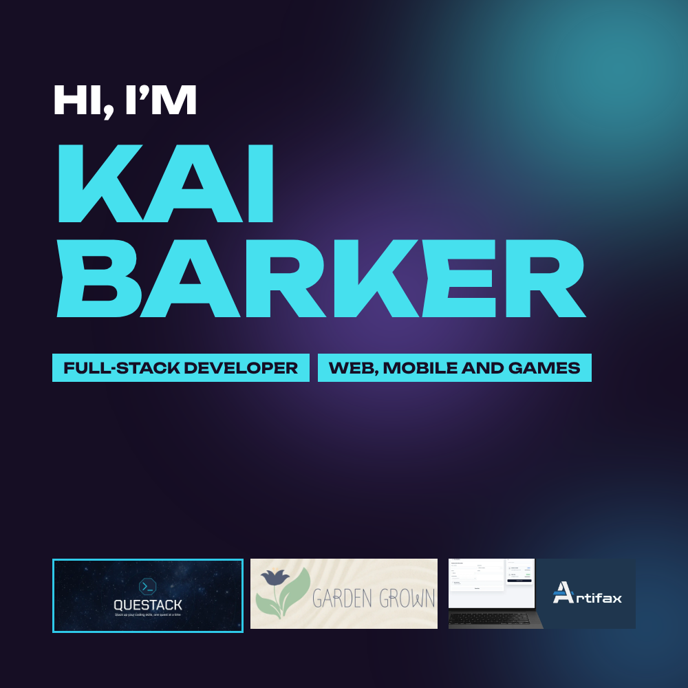

# Kai Barker | Developer Portfolio

## 👉 [View my portfolio: kai-barker.github.io](https://kai-barker.github.io)

This repository holds the source code for my portfolio site. To see my work, visit the live site at **https://kai-barker.github.io**.

I'm a full-stack web, mobile and game developer and a final-year Creative Technologies student at Open Window.

## Projects

| Project | What it is | Links |
| --- | --- | --- |
| **Questack** | A live, AI-driven web app that teaches you to read code | [Live site](https://www.questack.co.za/) · [Repository](https://github.com/Kai-Barker/Questack) |
| **Garden Grown** | A one-handed, stress-free zen garden mobile app | [Repository](https://github.com/Kai-Barker/GardenGrown) |
| **Artifax** | A team-built desktop app for inventory and production management | [Team repository](https://github.com/I-Know-What-You-Committed-Last-Summer/Artifax) · [My fork](https://github.com/Kai-Barker/Artifax) |

## Contact

- Email: [kaieddiebarker@gmail.com](mailto:kaieddiebarker@gmail.com)
- LinkedIn: [Kai Barker](https://www.linkedin.com/in/kai-barker-55945034a)
- GitHub: [Kai-Barker](https://github.com/Kai-Barker)
